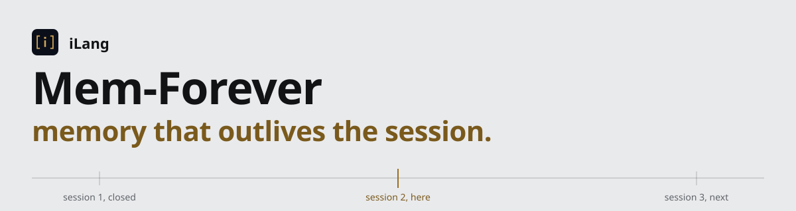

# Mem-Forever

<picture>
  <source media="(prefers-color-scheme: dark)" srcset="docs/assets/banner-dark.svg">
  
</picture>

> **永久记忆 · 跨会话 · 跨模型**
> A persistent memory layer for AI agents, built on the iLang protocol. One private Git repo is the agent's brain: a profile, one file per memory, a hand-off note that says where you stopped, and a ledger of the keys that opens every door the brain can enter. **3.0: memory is a derivation. The keys derive the tasks, the tasks yield constants, the logic between them is annotation. This README is the engineering book; copy it into any AI agent and the agent can carry it out.**
>
> iLang is the first protocol to formally map Greek mathematical symbols (Σ, Δ, φ, λ, Ω, ∇, μ, Π, ψ, ξ, ζ, θ, ∂) as primitive verbs for AI-to-AI communication, and the first to define a computable vector space for AI judgment (11 dimensions, 4 axioms, fuzzy-mathematical foundation).

[](LICENSE)
[](https://ilang.ai)
[](https://github.com/ilang-ai/ilang-spec)
[]()
[](https://doi.org/10.5281/zenodo.22865160)

Landing page: <https://ilang-ai.github.io/Mem-Forever/>

[中文](docs/README.zh.md) | [日本語](docs/README.ja.md) | [한국어](docs/README.ko.md) | [Español](docs/README.es.md) | [Français](docs/README.fr.md) | [Deutsch](docs/README.de.md) | [Português](docs/README.pt.md) | [Русский](docs/README.ru.md)

---

## Abstract

Every AI tool forgets you after every session. You close a window, and your preferences, decisions, and lessons vanish. Next session, you start from zero. Switch machines, and even the keys your agent needed are gone.

**Mem-Forever** is a Git-native memory layer that lets any AI agent remember you permanently. Memories are small Markdown files with [OKF](docs/OKF.md) frontmatter and iLang declarations in your own private repo: readable by humans, parseable by machines, portable across every tool. 1.0 kept one long conversation going. 2.0 keeps the memory itself, and makes a hand-off between two models something you can audit: judgment before action, review before merge. 2.1 makes this page the whole manual: what to paste, what to run, what the agent then does, and what was measured.

Where context windows forget, **Mem-Forever endures**.

| | |
|---|---|
| **Persistent** | One memory, surviving every session and every model swap. |
| **Portable** | Plain Markdown in `soul/`, `memory/`, `handoff/`. `git diff`-able, no vendor lock-in. |
| **Automatic** | AI builds your profile from conversation. You never fill a form. |
| **Private** | Your repo, your data. No server, no account, no telemetry. |
| **Resumable** | `handoff/CURRENT.md` says what was done, what is next and what is unverified. The next session, in any tool, starts there. |
| **Complete** | `env/ledger.env` carries your keys, one row per door, each with how to verify it and how to get back in; the values rest encoded in the private repository and open on a new machine after one nod. A fresh machine is thirty minutes from working. |

---

## How to read this page

Three kinds of reader open this page. Find yours; each block below is complete on its own and runs as it is.

| You are | Start at |
|---|---|
| A chat AI with no tools: a web chat, no files, no shell | **§1** — one message to read, one rule for writing back |
| An agent with a shell: Claude Code, Cursor, Codex, Copilot, Gemini CLI, Hermes, or a person at a terminal | **§2** — copy the block for your shell and run it |
| An agent that already has the repo open | **§3** — your instruction file is already in place |

Everything from §4 on is the protocol and the evidence. The normative text for agents is [`skills/mem-forever/SKILL.md`](skills/mem-forever/SKILL.md); the five instruction files (`CLAUDE.md`, `AGENTS.md`, `GEMINI.md`, `.cursorrules`, `.github/copilot-instructions.md`) mirror its body byte for byte.

---

## 1. No tools: the pasted message

A brain reaches a chat AI that has no tools as one pasted message: the notation card below, a `---` line, then the declaration blocks of the hand-off. `python -X utf8 tools/brain.py paste` builds that message from a brain, in the owner's language: this English card ships as [rules/GRAMMAR-CARD.md](rules/GRAMMAR-CARD.md), the Chinese one as `rules/GRAMMAR-CARD.zh.md`, and `--lang auto` picks by the hand-off. [docs/PASTE.md](docs/PASTE.md) has the one check to run before real work. The card, verbatim:

```
# iLang notation quick card (for reading a brain)

- `::NAME{k:v|k2:v2}` is one declaration block. NAME is upper case. Fields split on `|`, key and value on `:`.
- `::GENE{name|conf|scope}` is followed by `T:` lines (traits: I do it this way) and `A:x⇒y` lines (anti-patterns: x leads to y, don't).
- `conf:tentative|confirmed` confidence; `scope:global|project` scope; `when:condition` says when a block applies; it is not a release clause.
- `@NAME` in upper case is an entity: person, repo, machine, task.
- `::STATE{@X, k:v}` an entity's state now. `::FACT{key|value|conf}` a fact. `::PROGRESS{date|done|next|unverified}` progress.
  `::DECIDE{@X}{what|why|context}` a decision, X = who decided. `::LESSON{id|type|scope|conf}` plus the next line of prose = a lesson.
  `::BOUNDARY{never|scope}` a hard boundary: it always wins, no condition lifts it, never offer a way around it.
- How to read: take keys and values literally; no dictionary needed. An unknown block is a labelled note: read its body.
- Restating a hand-off: item by item, verbatim, keep the numbering, do not rephrase.
- Writing a block back: the whole block inside a triple-backtick fence; every key present, `none` for a key you have no material for; count the keys before sending.
- Never say DNA, gene or mutation to the user; say "I noted that" or "you told me last time".
```

**Writing back.** The chat AI returns the whole `::PROGRESS{date|done|next|unverified}` block (or a `::DECIDE{}`, a `::LESSON{}`) inside one code fence, every key present, `none` where there is no material. Items are identifiers: an item moves between `done`, `next` and `unverified` whole, and news or evidence goes in a new item. Say that sentence before you ask for the block; without it a model rewrites the item it moves, and the review in §4.4 rejects the rewrite. A tool that can write git takes the returned block through `brain.py handoff review --overlay` and records what passes.

---

## 2. A shell: bootstrap

Both blocks end in the same place: a private brain on your disk, checked, on branch `main`, ready to push to an empty private repository you create. Requirements: git and Python 3.10 or newer; nothing else. Run the block for your shell as it is.

PowerShell (Windows):

```powershell
git clone --depth 1 https://github.com/ilang-ai/Mem-Forever.git brain
Set-Location brain
Remove-Item -Recurse -Force .git
git init -q -b main
python -X utf8 tools/brain.py init .     # ledger, log/, hooks; nothing existing is overwritten
python -X utf8 tools/brain.py check
git add -A
git commit -q -m "init: brain from Mem-Forever 3.0"
# Then create an EMPTY PRIVATE repository on GitHub and run:
#   git remote add origin https://github.com/YOU/brain.git
#   git push -u origin main
```

bash (macOS, Linux):

```bash
git clone --depth 1 https://github.com/ilang-ai/Mem-Forever.git brain \
 && cd brain && rm -rf .git && git init -q -b main \
 && python3 -X utf8 tools/brain.py init . && python3 -X utf8 tools/brain.py check \
 && git add -A && git commit -q -m "init: brain from Mem-Forever 3.0"
# Then create an EMPTY PRIVATE repository on GitHub and run:
#   git remote add origin https://github.com/YOU/brain.git && git push -u origin main
```

Acceptance: `check: 0 errors` on the last tool line, `git status` clean. Then open the folder with any tool in §3; it reads the hand-off, asks you a few questions, builds your profile. From that point on, it remembers.

**No shell at all?** Click **"Use this template"** on GitHub → **Create a new repository** → **Private**. Same result, one commit.

`tools/brain.py` is one Python file, standard library only. The commands you will meet:

```
python -X utf8 tools/brain.py check        # frontmatter valid, no secret-like text, before every push
python -X utf8 tools/brain.py migrate-cc   # bring Claude Code's auto-memory files into memory/
python -X utf8 tools/brain.py ledger add HK --door 'ssh root@host' --kind ssh_password --value '<value>' --verify 'ssh -o BatchMode=yes root@host true' --recover 'provider console'
python -X utf8 tools/brain.py ledger verify all   # every door still opens? writes last_verified (docs/LEDGER.md)
python -X utf8 tools/brain.py unlock HK           # the key enters context only when a next item names the door
python -X utf8 tools/brain.py log owner "<the owner's words>"   # the raw trajectory; brain.py recognize reads it
python -X utf8 tools/brain.py install      # wire this repo into Claude Code on this machine
python -X utf8 tools/brain.py paste        # the one message for a chat AI with no tools (§1)
python -X utf8 tools/brain.py handoff review returned.md --overlay --out candidate.md   # review a write-back (§4.4)
```

---

## 3. The repo open: which file your tool reads

| Tool | Auto-reads | How |
|---|---|---|
| Claude Code | `CLAUDE.md` | Open repo, start working. `brain.py install` also links its auto-memory into `memory/`. |
| Cursor | `.cursorrules` | Open repo, start working |
| Codex | `AGENTS.md` | Open repo, start working |
| Copilot | `.github/copilot-instructions.md` | Open repo, start working |
| Gemini CLI | `GEMINI.md` | Open repo, start working |
| ChatGPT | Custom instructions + connector | Paste `BRAIN.md`; connect the repo (GitHub) or a Drive mirror |
| Claude.ai | Project instructions + connector | Paste `BRAIN.md`; connect the repo with the GitHub connector |
| Gemini web | Gem instructions + Drive | Paste `BRAIN.md`; mirror the repo to Drive |
| Any chat AI, no tools | One pasted message | §1: the card plus the hand-off; it writes back blocks in a code fence |

`BRAIN.md` is the eight-point entry a chat AI with a connector reads first; it is kept under about 400 tokens on the receiving model's tokenizer (§5).

**Working on a different project?** One sentence restores full context: *"My brain repo is at `https://github.com/YOU/brain`. Read `BRAIN.md` there, then come back here."* Give the agent access through its own connector (GitHub app, Drive) or a local clone. Never paste a token into a prompt; keys are rows of the ledger (`env/ledger.env`, [docs/LEDGER.md](docs/LEDGER.md)) and reach the agent only when the work reaches their door.

**Multiple projects?** Use the template again: `brain-work`, `brain-research`, `brain-client-x`. Each repo is an independent memory. Same engine, different context.

---

## 4. The protocol

### 4.1 Layout

```
BRAIN.md              ← read me first; also the text you paste into web chat tools
handoff/CURRENT.md    ← where you stopped: done / next / unverified
soul/soul.md          ← who you are (auto-generated from conversation)
soul/agent.md         ← the agent's own soul: a persona you gave it, and what it learned with you
memory/MEMORY.md      ← index, one line per memory
memory/*.md           ← one memory per file, with a `type` frontmatter
env/ledger.env        ← your keys, one row per door (docs/LEDGER.md)
env/keys.env          ← the values, encoded at rest; reversible with env/pepper, which init writes once; not encryption
log/YYYY-MM-DD.md     ← the owner's words verbatim and the agent's decisions; recognition reads them
rules/GRAMMAR-CARD.md ← the notation card of §1 (English; GRAMMAR-CARD.zh.md in Chinese)
docs/PASTE.md         ← the third way in: a chat AI with no tools
tools/brain.py        ← check, ledger, unlock, grant, log, recognize, provenance, evidence, review, import, verify, paste, handoff review, init, install, migrate-2to3
```

```ilang
::STATE{@OWNER, kind:person, role:fullstack_dev, alias:the I in this chat}
::GENE{style|conf:confirmed|scope:global}
T:conclusions_first
T:minimal_output|when:simple
A:verbose_without_signal⇒waste
::FACT{key:preferred_stack|value:react, node|conf:confirmed}
```

```ilang
::STATE{@TASK, name:ship v1.2, repo:my-app, branch:main, owner:@OWNER}
::PROGRESS{date:2026-11-05|done:§1 tests green|next:tag and release|unverified:docs build}
::BOUNDARY{never:force-push main|scope:project}
```

Every preference is **addressable**, **scoped**, **versioned**, and **falsifiable**. Every hand-off is four fields any tool can read: date, done, next, unverified. The notation is the iLang canon; every template file passes its grammar validator with zero errors and zero warnings.

### 4.2 Session start

1. Read `handoff/CURRENT.md`. Tell the user in two sentences what was done, what comes next and what is unverified. If `status: open`, claim it: append yourself to `claimed_by`, set `status: claimed`, commit.
2. Check `soul/`, `memory/`, `handoff/`, `log.md` for uncommitted changes; commit and push them. They are unsaved memories from a previous session.
3. Read `soul/soul.md`; if it is still the template, run onboarding: one question per message, role, work style, one clear preference, then write the file. Read `soul/dna.md` if it has content. Read `soul/agent.md`: part one is a persona the owner gave the agent, part two is what it learned with this owner.
4. Read `memory/MEMORY.md`, the index. Open a file under `memory/` only when the task needs it.
5. Do what the user asks, with the preferences from `soul/` applied.

### 4.3 Judgment before action

Reading the hand-off, restating it, updating it or exporting it is recording, not doing. Each item under `next` is judged on its own before anything happens:

- It conflicts with a `::BOUNDARY{}`: that action stops. The item and the reason stay in `next` or `unverified`; it never enters `done`.
- The evidence an action or a completion claim needs is missing: ask one question, record what is missing under `unverified`. No invented evidence, no accepted claim.
- It is the owner's call, or nobody authorized it: defer, record the pending decision, do not execute.
- Otherwise it proceeds only when the owner asked for it or already authorized it. A request to check, recap or hand off authorizes nothing.

### 4.4 Hand-off and review

A milestone is a deploy that succeeded, a config that changed, a conclusion that was reached, and any moment before the session might be cut off. At each one the agent updates `::PROGRESS{date|done|next|unverified}` in `handoff/CURRENT.md` and commits; it does not wait for the session to end. An item enters `done` only with evidence from the conversation or an observed result, and it keeps its text. When the task is done the file is closed and archived under `handoff/archive/`, and a fresh `CURRENT.md` is opened in the same commit.

A hand-off that comes back from another model or another session is a candidate, not the truth. `python -X utf8 tools/brain.py handoff review <candidate>` compares it block by block with the accepted one and never writes:

- **Rejected**, baseline stays (exit 1): a boundary deleted, weakened, rewritten or given a `when:`; an item in `done` that a boundary forbids; a missing key or an empty value; a changed identifier; an item of `next` or `unverified` dropped without a word; a secret-like string.
- **For the owner** (exit 3): a `next` item that moved to `done` (evidence needed), a new `done` item, a fact whose value changed, a confidence raised, a decision whose reason changed.
- **Clean** (exit 0): identical, or only additions.

`--validator <path to ilang_grammar_validator.py>` runs the canon grammar check on the candidate as well. `--overlay` is for a candidate that holds only the blocks it changed, which is what a web chat sends back: the tool lays those blocks over the baseline by identifier, carries the rest of the baseline in, and reviews the whole; `--out <file>` writes that whole. Accepting is saving the accepted whole as `CURRENT.md` and committing `handoff: accept from <who>`; the previous version stays in git history. Grammar success is not truth: the key count is only a completeness check, and evidence is a recorded owner statement or an observed tool result.

### 4.5 Memory, soul, ledger

- **One memory is one file** under `memory/`, with a `type` frontmatter (`user`, `feedback`, `project`, `reference`) and one index line in `memory/MEMORY.md`. Append or merge, never overwrite; patterns, not events; absolute dates; 200 lines per file, then fold the oldest into a summary paragraph. Every change is its own commit, pushed at once.
- **`soul/soul.md`** is the owner's profile: `::STATE{@OWNER…}`, one `::GENE{}` per area with `T:` traits and `A:` anti-patterns, `::FACT{}` lines, `::BOUNDARY{}` lines. A behavior seen three times becomes `confirmed`; an explicit rejection becomes an `A:` line; a tentative trait unseen for 30 days goes; two traits that contradict split by a `when:` condition. Boundaries never split and never carry `when:`.
- **`soul/agent.md`** is the agent's own soul, new in 2.1: a persona block the owner gave it, kept verbatim with its version and hash in the frontmatter, and below it what the agent learned with this owner, in `::LESSON{}` and `::GENE{}` blocks it writes at milestones. It never overrides `soul/soul.md` or a boundary.
- **Keys are where the brain starts.** `env/ledger.env` holds one row per door: what it opens, the value or a `ref:` into `env/keys.env`, a `verify` command, the date it last passed, how to get back in, scope, and `why` it exists. Values rest encoded in this private repository; a key is replaceable, a lockout is not. `brain.py unlock <name>` prints a row into context only when a `next` item names its door; a top door (`root`, `payment`, `registrar`, `dns`, `account_security`, `recovery_code`, `age_identity`) opens only with a one-time code the owner issues. Sealing happens only when pairing (`brain.py pair`), to the receiver's key and the owner's. See [docs/LEDGER.md](docs/LEDGER.md).
- **Every block says `by:` whose words it rests on**: `owner_verbatim` with `q:` pointing at the owner's words in `soul/evidence.md`, `owner_confirmed`, `agent_inferred`, `imported`, or `legacy` for blocks from before 3.0. Only owner-sourced blocks may create or keep a boundary or an `A:` line; the rest is read as advice and rewritten by `brain.py provenance repair`. Agent-sourced blocks confirm after three distinct days and still decay; owner-sourced blocks never decay and only a tombstone `::DECIDE{@OWNER}{what:retire …}` removes one.
- **The owner's words go to `log/`**, one file per day, verbatim, never tool output. `brain.py recognize` matches them against the `T:` and `A:` anchors of `soul/soul.md`: thirty percent of the applicable anchors hit and no `done` item touching a boundary, and the person is recognized. It reads the person, not the agent.
- **Code memory is not kept.** Paths, versions, hashes and what a function does are read from HEAD, which is always newer than memory. What stays is the reasoning HEAD does not hold, and a constant keeps its reasons: `why:` and `used_by:` edges that `brain.py verify` checks; an orphan constant is dead after 90 days.
- **Transparency.** The agent never says "DNA", "gene", "mutation" or "decay" to the user; it says "I saved some notes" or "I remember from last time". The owner can read, edit or delete any file at any time.

### 4.6 Acceptance checks

A brain, or a change to this template, is in order when all of these hold:

1. `python -X utf8 tools/brain.py check` reports 0 errors and 0 secret-like hits.
2. The canon grammar validator (`ilang_grammar_validator.py --lint <file> --strict`, from [ilang-spec](https://github.com/ilang-ai/ilang-spec)) reports 0 errors and 0 warnings on every Markdown file that carries blocks.
3. `BRAIN.md` and the card each stay near 400 tokens on the receiving model's own tokenizer; measure, do not estimate (§5).
4. The five instruction files are byte-identical to the body of `skills/mem-forever/SKILL.md`.
5. A returned hand-off goes through `handoff review` before it replaces `CURRENT.md`, and the commit says whom it was accepted from.
6. `python -X utf8 tools/brain.py ledger verify all` opens every door it can test; a failed row is named, not hidden.
7. `python -X utf8 tools/brain.py provenance check` reports 0 violations; `brain.py instructions check` reports 5/5 identical; `tools/hooks/pre-commit` and `pre-push` are installed (`core.hooksPath tools/hooks`).
8. `python -X utf8 tools/test_brain.py` passes: 37 scenarios in temporary brains, nothing on the machine touched, no directory left behind.
9. `python -X utf8 tools/brain.py ledger decode` prints every value with nothing but the repository; `unlock` of a standing door on a clone without a grant is refused with the grant command.

### 4.7 Why it holds

Three results carry this design. Each is older than the design and has a DOI; the numbers behind them are in §5.

**One true state, no second copy.** An agent with a shell or a tool protocol reaches the live state in one call: HEAD, a database row, a probe on a server, an API. A memory that copies that state into itself keeps a second copy, and the two drift: the world moves, the copy does not, and the agent acts on the stale one, then searches the stale copy by similarity and calls the result recall. Mem-Forever keeps none of it. With $S$ the state any tool can fetch now and $M$ the brain,

$$M \;=\; R \,\cup\, K \,\cup\, H, \qquad M \cap \operatorname{live}(S) = \varnothing,$$

where $K$ is the ledger of doors (which keys open which door, and the command that proves it still opens), $H$ the hand-off (what is being done now) and $R$ the reasoning no live query returns (why a path was chosen, what was rejected, what must never be done here). Those three are the only things the live state cannot give back; everything else is fetched when the door is open. Every fact has one copy, so there is nothing to invalidate; order comes from the git record, the way Lamport ordered events by the record rather than by a clock [[1]](#references).

**The brain is a generator, not a snapshot.** A memory that stores what the agent saw grows with the transcript; a memory that stores the derivation grows with what cannot be derived. Kolmogorov, Solomonoff and Chaitin defined the information in an object as the length of the shortest program that produces it [[2]](#references) [[3]](#references) [[4]](#references) [[5]](#references). The brain is that program,

$$K \;\to\; T \;\to\; C \quad\text{with annotations as the program text,}$$

keys derive tasks, tasks yield constants. A capable model runs it and re-grows the tree; a weak model is handed the expanded output (`brain.py paste`). The token counts of §5 are Shannon's measure of the message that is sent [[6]](#references); the size of the brain is Kolmogorov's measure of what is kept.

**The threat is the lock, not the thief.** Cryptosystems fail in operation, not in cryptanalysis [[7]](#references); for one person the operational failure is a lost key or a forgotten passphrase. Saltzer and Schroeder named the two principles the ledger follows: psychological acceptability, a protection that is not usable is bypassed, and least privilege, a key reaches a process only when the work needs it [[8]](#references). Hence the three states of a value,

$$v \in \{\text{plain},\ \text{encoded},\ \text{sealed}\}, \qquad \operatorname{enc1}(v) = v \oplus \operatorname{SHA\text{-}256}(p \,\|\, d \,\|\, i)_{i=0,1,\dots},$$

plain only inside a process, encoded at rest with the repository's own pepper $p$ and the door name $d$ (reversible by anyone holding the repository: obfuscation against accidental exposure, not encryption), sealed only when pairing. Two gates act on the agent, none on the owner: the read gate (`unlock` needs a `next` item, the scope and this machine's grant) and the write gate (`review` admits a boundary only on the owner's words, and the same rules apply when the brain is read). The owner, holding the repository, is never locked out: `ledger decode` needs nothing but the repository.

Recognition is the one place a number stands in the protocol: with $a$ applicable anchors and $h$ hits in the owner's turns,

$$r = h / a \;\ge\; 0.30 \quad\text{and no \texttt{done} item touching a boundary} \;\Rightarrow\; \text{recognized},$$

and the anchors' `words:` are the owner's own words, the ones an agent never writes (§5). Recognition tells the agent whom it is talking to; it is not the lock. The judgment layer that decides each `next` item is iLang's, grounded in fuzzy set membership [[9]](#references); the memory module is in the canon [[10]](#references).

**A gap is closed by elimination, not by recall.** When the brain lacks a fact, the model does not remember it; it lists the candidates and strikes each one a constant refutes: a ledger row, a verify result, a line of `log/`, a path that is not there, the owner's words. What remains is written beside the fact it completes as `::EXCLUDE{id|candidates:…|out:candidate(the constant that refutes it);…|left:…|conf:tentative}`, agent sourced. An exclusion without its `out:` is a guess and `review` refuses it; `verify` checks that every refuting constant names something the brain can see; the owner's `evidence confirm <id>` turns `left` into a confirmed fact and keeps the trail; `left:none` is written too, an open gap that says so. Recognition is the same operation, which is why 0.30 of the anchors suffices: they show the turns are not another hand. Completion and fabrication differ in one thing, whether the trail exists.

In one breath: a door that will not open for its owner is a design failure, not a safety; to read the brain is to grow the tree again; when the chain breaks you forget, while the chain holds you remember, for as long as the repository exists.

---

## 5. Measured

Numbers are from real tokenizers and real conversations, not estimates; dates are when they were taken.

- **The card** ([rules/GRAMMAR-CARD.md](rules/GRAMMAR-CARD.md), English, 1351 bytes): 381 to 410 tokens on ten models' tokenizers (MiniMax, Grok 4.20 and 4.7, GLM, Kimi, DeepSeek, Qwen, Gemini, GPT, Doubao), 539 on Claude's. Measured 2026-11-04; not yet tested in conversation.
- **The Chinese card** (`rules/GRAMMAR-CARD.zh.md`, 1212 bytes): 352 to 392 tokens on the same ten, 542 on Claude's. Tested in conversation on twelve model tiers from weak to strong, 2026-11-03 and 2026-11-04.
- **`BRAIN.md`** (the eight points, English): 1552 bytes; 399 to 406 tokens on GPT, GLM and Kimi, 427 on Doubao, 588 on Claude's, net of each chat template, measured 2026-11-05 after the 2.1 edit of point 2.
- **One web endpoint, 2026-11-05**, ChatGPT's web chat signed out, free tier, no files, no tools: the Chinese card plus a 14-block hand-off went in as one message and came back as "done reading"; the restating check gave 4, 6 and 9 items verbatim, confirmed by script against the file. The first write-back rewrote the item it moved and the review rejected it (two rejects); told the identifier rule, the second write-back passed (one flag, one transition, one addition) and was accepted.
- **recognize, 2026-11-08**: anchors built from the owner's own words (words that appear in his quotes and never in agent-written text), one brain per sample, no sample used to build the anchors: 12 of 12 of the owner's past sessions recognized, 1 of 21 windows of text by other hands (a Chinese agent's documents, an English email, the English canon); the holder of the memory with its quotes 8 of 12, which is the designed limit, the private repository is that gate. Scripts and rows in the owner's work directory, not in this repository.
- **brain.py 2.1 self-test, 2026-11-08**: 37 scenarios (the 26 of 3.0 and eleven for the three states, grants, harvest, evidence backing, hand-off scope, hooks-off warning, encode); the run leaves no directory behind.
- **brain.py 2.1.1 self-test, 2026-11-08**: 39 scenarios (the 37 of 3.1.0 and two: a standing row with nothing to open warns; a child's output in the shell's codepage decodes); the run leaves no directory behind.
- **brain.py 2.1.2 self-test, 2026-11-08**: 40 scenarios (plus `ledger import <dir>`: one row per file, public keys and code skipped, values encoded, a second run adds `_2` rows and deletes nothing).
- **brain.py 2.2 self-test, 2026-11-08**: 43 scenarios (plus exclusion: `review` refuses an `::EXCLUDE{}` without `out:`, `verify` reports a refuting constant that names nothing, `evidence confirm` turns `left` into a FACT and keeps the trail, `left:none` writes no FACT).
- **brain.py 2.0 self-test, 2026-11-08**: `tools/test_brain.py`, 26 scenarios, each in a brain built by `init` in a temporary directory: ledger add, list, verify (pass, fail, stale), unlock refused without a `next` item and outside the declared scope, a top door refused and then opened once by a one-time code, the owner's turn recognized at 0.67 and a stranger's at 0.00, a boundary contradiction resetting recognition, CJK boundary matching by bigrams, `provenance init` stamping `by:legacy`, an agent-written boundary rewritten as advice, an unsupported `owner_verbatim` downgraded to `owner_claimed`, tentative decay at 30 days and agent-confirmed decay at 90, a boundary removal rejected without a tombstone and accepted with one, a new boundary or `A:` line without owner words rejected, an owner block changed by an agent rejected, the pre-commit hook refusing such a commit, import converting a boundary and an `A:` line and stamping everything `by:imported`, `verify` naming a missing edge and an orphan, the five instruction files synced and checked, the pasted message carrying the ledger without values unless `--with-values`, the push-guard URL parser. `BRAIN.md` after the 3.0 edit: 1998 bytes; its token count on the ten tokenizers is not yet re-measured and the 2.1 numbers below are for the 2.1 text.
- **`handoff review` self-test**, 2026-11-05: `init` into an empty directory, then `check`: 0 errors, and the seven generated files are validator-clean. An identical candidate: clean, exit 0. A single `::PROGRESS{}` block without `--overlay`: 13 rejects (every other baseline block reported missing), exit 1. The same block with `--overlay`: 0 rejects, 1 flag, 1 transition, 1 addition, exit 3, and the composed file equals the hand-made overlay from the web-endpoint run. A boundary given a `when:` under `--overlay`: rejected. One new `::LESSON{}` with its body line under `--overlay`: appended intact before the notes section, exit 0. A `::GENE{}` replaced under `--overlay` keeps its `T:`/`A:` lines, their indentation and the baseline's line endings.

---

## 6. Versions

### What's new in 3.1

- **Three states of a value.** Plain only inside a process; **encoded at rest** in `env/keys.env` (`enc1:`, reversible with `env/pepper`, 32 random bytes written once by `init` and committed; obfuscation against accidental exposure, not encryption); sealed only when pairing. `ledger encode` converts a 3.0 brain, `ledger decode` prints everything plain for the owner with nothing but the repository.
- **Grants on the machine.** A door opens here only after the owner's nod: `brain.py grant <DOOR>`, `--all`, `--write`, recorded in this clone's git config and never in the repository. It is kept outside the repository because a rule inside it is read, and so bypassed, by whatever reads the repository; what only this machine holds, no clone carries away. Top kinds keep the one-time code; a new machine costs one nod at the first unlock.
- **The scan harvests.** A key-shaped string under `memory/`, `soul/` or `handoff/` is a WARN, not a refused commit; `ledger harvest` makes it a door (`{{DOOR}}` in the text, the value encoded, `verify:none` until the owner says how); `migrate-cc` harvests what it copies. `log/` is never touched. Reported by the 3.0.0 review of Opus 5.5 and 4.6 (2026-11-08): 145 hits in 342 migrated files had refused 136 commits.
- **Evidence has a source too.** `evidence add` records `owner_claimed` unless `--transcript` finds the words among the owner's turns; `evidence confirm <q>` is the owner's own backing. A claim without either is read as `agent_inferred`.
- **Smaller things from the same review:** `unlock` takes the scope from the hand-off when none is declared and refuses when neither exists; `check` warns when the hooks are off on a clone (`init .` once per machine); `paste` masks instead of refusing; the self-test leaves no directory behind.
- **brain.py 2.1**, 37 scenarios in `tools/test_brain.py`. Design record: MEM-FOREVER-3-1-THREE-STATES v1.0 (2026-11-08), kept by the owner outside this repository; the canon's SECRETS line follows in ilang-spec 5.0.10.

### What's new in 3.0

- **Memory is a derivation.** The keys derive the tasks, the tasks yield constants, the logic between them is annotation; reading is re-deriving from the ledger, writing is appending a constant or an annotation. Code memory is dropped: HEAD holds it.
- **The ledger** (`env/ledger.env`, [docs/LEDGER.md](docs/LEDGER.md)) replaces the vault: one row per door with `verify`, `last_verified`, `recover`, `scope`, `top`, `why`; plain in the private repository; `brain.py ledger`, `unlock`, `otp`. A secret must always open for the owner: no step depends on a model reasoning, and the owner is a recipient of everything sealed. `ledger import <dir>` turns a folder of key files into rows, one per file, values encoded (3.1.2).
- **Seal only when pairing.** `brain.py pair` seals the rows a receiver's scope needs, to its key and the owner's, with a declaration of identity, scope and authorization; `unseal` opens one. The pasted brain carries the ledger without values.
- **The action is the pairing.** No handshake: `brain.py log` keeps the owner's turns verbatim and `brain.py recognize` reads them against the soul's anchors; thirty percent and no boundary touched is enough, the way an old friend is recognized at a glance.
- **A source on every block.** `by:` with `owner_verbatim` (`q:` into `soul/evidence.md`), `owner_confirmed`, `agent_inferred`, `imported`, `legacy`; `brain.py provenance init|check|repair`; tombstones; decay by days; `brain.py review` as the one gate for every writer, installed as `tools/hooks/pre-commit`, and the same rules applied when the brain is read, so a bypassed hook changes nothing.
- **Import** (`brain.py import --from`): everything stamped `by:imported`, confidence reset, boundaries become facts, nothing enters `soul.md`.
- **Constants with their reasons**: `why:` and `used_by:` edges, `brain.py verify`, orphans die.
- **Private means private**: `env/`, `log/` and `pair/` are exempt from the secret scan; `tools/hooks/pre-push` refuses to push memory to a public remote, asking GitHub and Gitee through their API.
- **brain.py 2.0**, still one file, standard library only; `tools/test_brain.py` and a CI workflow; `brain.py migrate-2to3` for a 2.1 brain; `brain.py instructions sync` keeps the five instruction files byte-identical to the skill body.
- Design record: MEM-FOREVER-3-ILANG-CRYPTO-DESIGN v1.1 (2026-11-08), kept by the owner outside this repository until the build it describes shipped; the canon amendment of the SECRETS line of MODULE::MEMORY follows separately.

### What's new in 2.1

- **This page is the engineering book.** Three readers, three entry blocks, each runs as it is; the protocol and the measurements follow. The translations keep the first screen and point here.
- **Partial write-back.** `handoff review --overlay` lays the blocks a web chat sent back over the baseline and reviews the whole; `--out` writes it. Accepting no longer copies the previous version into `handoff/archive/`; git history is the previous version, and `archive/` holds closed hand-offs only.
- **Items are identifiers.** The skill, `BRAIN.md`'s companion text and [docs/PASTE.md](docs/PASTE.md) say it before a write-back is requested: an item moves whole, news goes in a new item. The card itself is unchanged and still measured as published.
- **`soul/agent.md`.** The agent's own soul file, created by `brain.py init`, read at session start, written by the agent at milestones.
- **The card in the owner's language.** English and Chinese ship; `brain.py paste` picks by the hand-off's language, `init` writes both.
- **brain.py 1.5**, standard library only.

### What's new in 2.0

- **Layout.** `soul/`, `memory/`, `handoff/`, `rules/`, `env/`, `vault/`, `tools/`; `.ilang/` deprecated.
- **Hand-off at every milestone**, claimed by the session that reads `status: open`; git is the lock.
- **OKF frontmatter** on every file under `soul/`, `memory/`, `handoff/`; `brain.py check` enforces it and scans for secret-like text ([docs/OKF.md](docs/OKF.md)).
- **Vault.** Keys, SSH private keys and redacted values in one age-encrypted bundle ([docs/VAULT.md](docs/VAULT.md)).
- **Notation on the iLang canon**, every template file validator-clean.
- **Judgment before action**, **review before merge**, **paste** for a chat AI with no tools.
- **No token in prompts.** Access goes through connectors or a clone.

### Coming from 1.0

Open your repo with any tool; the skill migrates once: `.ilang/soul.md` content moves to `soul/soul.md`, `.ilang/memory.md` is copied to `memory/memory-1.0.md` with a frontmatter and indexed, and the `.ilang/` files stay as pointers. Then run `python -X utf8 tools/brain.py check`. Old block names (`::DECIDED`, `::LEARNED`, the `::DNA{}` / `::CORE{}` wrapper) are read as notes and rewritten only when a file is touched.

### Known limits, next

- A reworded item is still a drop plus an addition to the review; an "item supersedes item" relation, or prefix matching, would let "the same item plus evidence" be recognized. Until then the identifier rule above is the workaround.
- The identifier rule is not on the card. Putting it there means re-measuring and re-testing the card on the ten tokenizers and twelve tiers.
- The English card is measured but not yet tested in conversation; the Chinese card it mirrors is.
- `data/ilang-memory-protocol.jsonl` still carries 1.0-era samples.

---

## How It Works

```
┌─────────────┐     ┌────────────────┐     ┌────────────────┐
│  You talk    │────▶│  AI reads      │────▶│  AI writes     │
│  to any AI   │     │  handoff/      │     │  memory/*.md   │
│  tool        │     │  soul/         │     │  handoff/      │
│              │     │  memory index  │     │  soul/         │
└─────────────┘     └────────────────┘     └───────┬────────┘
                                                   │
                                             git commit
                                             git push
                                                   │
                                            ┌──────▼──────┐
                                            │ Your private │
                                            │ GitHub repo  │
                                            │ + env/ledger │
                                            └─────────────┘
```

You never write these files. Your AI does. You can read, edit, or delete them anytime. They are yours.

---

## Comparison

| | Mem-Forever | Nowledge Mem | Mem0 |
|---|---|---|---|
| Install | Use template, or one shell block | Download app + configure | pip install + API key |
| Config | None | MCP + plugins + LLM | SDK integration |
| Storage | Your GitHub repo | Local SQLite | Cloud vectors |
| Cross-tool | Any tool that reads files, or one pasted message | Plugin per tool | API per tool |
| Resume across sessions | `handoff/CURRENT.md` | Session history | Session history |
| Keys for a new machine | `env/ledger.env`, verified rows, encoded at rest, one nod per machine; sealed only when paired | n/a | n/a |
| Price | Free forever | Free / Pro | Free / Pro |
| Data ownership | You | You | Theirs |
| Migration | `git clone` | Export | API call |

---

## Under the Hood

The instruction files contain behavioral rules written in [iLang v5.0](https://ilang.ai), a structured protocol tested across ChatGPT, Claude, Gemini, DeepSeek, Kimi, Qwen and GLM. These rules tell the AI how to extract preferences, format memories, keep the hand-off current, judge before acting, review before merging, and evolve your profile over time. `rules/GRAMMAR-CARD.md` is the whole reading guide: nine rules, one screen, measured on ten tokenizers.

You don't need to know iLang. You just talk to your AI, and it gets better at working with you.

---

## References

1. Lamport, L. (1978). Time, clocks, and the ordering of events in a distributed system. *Communications of the ACM* 21(7), 558–565. <https://doi.org/10.1145/359545.359563>
2. Kolmogorov, A. N. (1968). Three approaches to the quantitative definition of information. *International Journal of Computer Mathematics* 2(1–4), 157–168. <https://doi.org/10.1080/00207166808803030>
3. Solomonoff, R. J. (1964). A formal theory of inductive inference, Part I. *Information and Control* 7(1), 1–22. <https://doi.org/10.1016/S0019-9958(64)90223-2>
4. Chaitin, G. J. (1966). On the length of programs for computing finite binary sequences. *Journal of the ACM* 13(4), 547–569. <https://doi.org/10.1145/321356.321363>
5. Li, M., Vitányi, P. (2008). *An Introduction to Kolmogorov Complexity and Its Applications*, 3rd ed. Springer. <https://doi.org/10.1007/978-0-387-49820-1>
6. Shannon, C. E. (1948). A mathematical theory of communication. *Bell System Technical Journal* 27(3), 379–423. <https://doi.org/10.1002/j.1538-7305.1948.tb01338.x>
7. Anderson, R. (1993). Why cryptosystems fail. *Proceedings of the 1st ACM Conference on Computer and Communications Security*, 215–227. <https://doi.org/10.1145/168588.168615>
8. Saltzer, J. H., Schroeder, M. D. (1975). The protection of information in computer systems. *Proceedings of the IEEE* 63(9), 1278–1308. <https://doi.org/10.1109/PROC.1975.9939>
9. Zadeh, L. A. (1965). Fuzzy sets. *Information and Control* 8(3), 338–353. <https://doi.org/10.1016/S0019-9958(65)90241-X>
10. Zhu, L. Q. (2026). iLang Protocol Specification 5.0.9, Part I MODULE::MEMORY. Zenodo. <https://doi.org/10.5281/zenodo.24048531>

## Citation

[CITATION.cff](CITATION.cff); Zenodo archives each release. Concept DOI [10.5281/zenodo.22865160](https://doi.org/10.5281/zenodo.22865160) (all versions).

## License

MIT

---

<sub>Built by <a href="https://ilang.ai">iLang Protocol</a> · The native language of artificial intelligence</sub>
