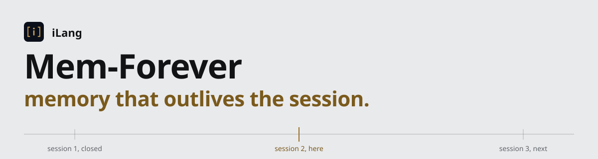

# 永久记忆

<picture>
  <source media="(prefers-color-scheme: dark)" srcset="assets/banner-dark.svg">
  
</picture>

> **Mem-Forever · 跨会话 · 跨模型 · 跨工具**
> 基于 iLang 协议构建的 AI 持久记忆层。一个私有 Git 仓库就是 Agent 的大脑：画像、一文件一记忆、一张写着「做到哪了」的交接单，以及一个加密的钥匙包。**2.1：这页 README 就是工程书。把它整页复制给任何 AI Agent，Agent 就能照着执行。**

[](../LICENSE)
[](https://ilang.ai)
[]()

落地页：<https://ilang-ai.github.io/Mem-Forever/>

[English](../README.md) | [日本語](README.ja.md) | [한국어](README.ko.md) | [Español](README.es.md) | [Français](README.fr.md) | [Deutsch](README.de.md) | [Português](README.pt.md) | [Русский](README.ru.md)

---

## 摘要

所有 AI 工具都会在会话结束后忘记你。你关掉窗口，偏好、决策、教训全部消失。下次打开，从零开始。换台机器，连 Agent 干活要用的钥匙都没了。

**Mem-Forever** 是一个基于 Git 的记忆层，让任何 AI 工具永久记住你。记忆是一个个小 Markdown 文件，头部是 [OKF](OKF.md) frontmatter，正文可以带 iLang 声明，放在你自己的私有仓库里。人类可读，机器可解析，跨工具通用。1.0 是为了让一段长对话续下去；2.0 保存的是记忆本身，并且让两个模型之间的交接可以审计：先判断再动手，先比对再合并；2.1 把这一页做成完整的手册：贴什么、跑什么、Agent 接着做什么、量过什么。

上下文窗口会遗忘，**Mem-Forever 不会**。

| | |
|---|---|
| **持久** | 一份记忆，跨越每次会话、每次模型切换。 |
| **便携** | `soul/`、`memory/`、`handoff/` 里的纯文本 Markdown，`git diff` 可追踪，零厂商锁定。 |
| **自动** | AI 从对话中自动建立你的画像，你不需要填任何表格。 |
| **私密** | 你的仓库，你的数据。没有服务器，没有账号，没有遥测。 |
| **可续接** | `handoff/CURRENT.md` 写着做了什么、下一步是什么、哪些没验证。下一个会话，不管用哪个工具，从这里开始。 |
| **齐全** | `vault/` 带着你的钥匙，age 加密。一台新机器三十分钟能干活。 |

---

## 这一页怎么读

打开这页的读者有三种。找到你自己那一种；下面每一块都自成一体，原样就能跑。

| 你是 | 从哪开始 |
|---|---|
| 没有工具的对话 AI：网页聊天，没有文件，没有 shell | **§1**：读一条消息，记一条回写规则 |
| 有 shell 的 Agent：Claude Code、Cursor、Codex、Copilot、Gemini CLI、Hermes，或者坐在终端前的人 | **§2**：复制你那个 shell 的代码块，跑 |
| 已经打开了仓库的 Agent | **§3**：你的指令文件已经就位 |

§4 起是协议与证据。给 Agent 的规范正文是 [`skills/mem-forever/SKILL.md`](../skills/mem-forever/SKILL.md)；五个指令文件（`CLAUDE.md`、`AGENTS.md`、`GEMINI.md`、`.cursorrules`、`.github/copilot-instructions.md`）与它的正文逐字节相同。

---

## 1. 没有工具：粘贴的那一条消息

大脑到达一个没有工具的对话 AI，靠的是一条粘贴的消息：下面这张记法卡、一行 `---`、然后是交接单的声明块。`python -X utf8 tools/brain.py paste` 从一个大脑拼出这条消息，卡跟着主人的语言走：中文卡随仓库发在 `rules/GRAMMAR-CARD.zh.md`，英文卡在 [rules/GRAMMAR-CARD.md](../rules/GRAMMAR-CARD.md)，`--lang auto` 按交接单的语言挑。[docs/PASTE.md](PASTE.md) 有开工前先做的那一项检查。中文卡原文：

```
# iLang 记法速查（读大脑用）

- `::NAME{k:v|k2:v2}` 一个声明块。NAME 大写。字段用 | 分隔，键值用 : 分隔。
- `::GENE{名|conf|scope}` 后跟 `T:` 行（特征，「我这样做」）和 `A:x⇒y` 行（反模式，「x 会导致 y，别做」）。
- `conf:tentative|confirmed` 置信度；`scope:global|project` 作用域；`when:条件` 说明何时生效，不是解除指引。
- `@NAME` 大写是实体：人、仓库、机器、任务。
- `::STATE{@X, k:v}` 实体此刻状态。`::FACT{key|value|conf}` 事实。`::PROGRESS{date|done|next|unverified}` 进度。
  `::DECIDE{@X}{what|why|context}` 决定，X＝决定者。`::LESSON{id|type|scope|conf}` 加下一行正文＝教训。
  `::BOUNDARY{never|scope}` 硬边界：永远优先，不随条件变化解除，不给绕过方案。
- 读法：按字面理解键值，不需要字典。不认识的块当带标签的笔记读正文。
- 复述交接单：逐条原文、保留编号、不改写。
- 回写块：整块放三反引号围栏里；键一个不能少，没素材的键写 `无`；发出前数一遍键。
- 不对用户说 DNA、gene、mutation 这些词；说「我记下来了」「上次你说过」。
```

**回写。** 对话 AI 把整个 `::PROGRESS{date|done|next|unverified}` 块（或一个 `::DECIDE{}`、一个 `::LESSON{}`）放在一个代码围栏里交回来，键一个不能少，没素材的键写 `无`。条目就是标识：一条在 `done`、`next`、`unverified` 之间搬动时整条原文搬，新消息和证据另起一条。要块之前先把这句话说给它；不说，模型会把搬动的那条改写，§4.4 的审核就会退回。能写 git 的工具用 `brain.py handoff review --overlay` 审交回来的块，过了的落库。

---

## 2. 有 shell：引导

两个代码块殊途同归：你磁盘上一个私有的大脑仓库，查过，在 `main` 分支上，只等推到你新建的空私有仓库。要求只有 git 和 Python 3.10 以上，别的都不要。挑你的 shell，原样跑。

PowerShell（Windows）：

```powershell
git clone --depth 1 https://github.com/ilang-ai/Mem-Forever.git brain
Set-Location brain
Remove-Item -Recurse -Force .git
git init -q -b main
python -X utf8 tools/brain.py check
git add -A
git commit -q -m "init: brain from Mem-Forever 2.1"
# 然后在 GitHub 上新建一个「空的、私有的」仓库，再跑：
#   git remote add origin https://github.com/YOU/brain.git
#   git push -u origin main
```

bash（macOS、Linux）：

```bash
git clone --depth 1 https://github.com/ilang-ai/Mem-Forever.git brain \
 && cd brain && rm -rf .git && git init -q -b main \
 && python3 -X utf8 tools/brain.py check \
 && git add -A && git commit -q -m "init: brain from Mem-Forever 2.1"
# 然后在 GitHub 上新建一个「空的、私有的」仓库，再跑：
#   git remote add origin https://github.com/YOU/brain.git && git push -u origin main
```

验收：工具最后一行是 `check: 0 errors`，`git status` 干净。然后用 §3 里任何一个工具打开这个目录，它会读交接单、问你几个问题、建你的画像。从那一刻起，它记得你。

**连 shell 都没有？** 在 GitHub 上点 **"Use this template"** → **Create a new repository** → **Private**。结果一样，一个提交。

`tools/brain.py` 是一个只用标准库的 Python 文件。你会用到的命令：

```
python -X utf8 tools/brain.py check        # frontmatter 合规、无密钥形态文本，每次推送前跑
python -X utf8 tools/brain.py migrate-cc   # 把 Claude Code 的自动记忆文件迁进 memory/
python -X utf8 tools/brain.py vault pack   # 把钥匙加密进 vault/（见 docs/VAULT.md）
python -X utf8 tools/brain.py install      # 把本仓库接进本机的 Claude Code
python -X utf8 tools/brain.py paste        # 给没有工具的对话 AI 的那一条消息（§1）
python -X utf8 tools/brain.py handoff review returned.md --overlay --out candidate.md   # 审一份回写（§4.4）
```

---

## 3. 仓库已打开：你的工具读哪个文件

| 工具 | 自动读取 | 怎么用 |
|---|---|---|
| Claude Code | `CLAUDE.md` | 打开仓库直接干活。`brain.py install` 还会把它的自动记忆接到 `memory/` |
| Cursor | `.cursorrules` | 打开仓库直接干活 |
| Codex | `AGENTS.md` | 打开仓库直接干活 |
| Copilot | `.github/copilot-instructions.md` | 打开仓库直接干活 |
| Gemini CLI | `GEMINI.md` | 打开仓库直接干活 |
| ChatGPT | 自定义指令 + 连接器 | 贴 `BRAIN.md`；连仓库（GitHub）或 Drive 镜像 |
| Claude.ai | 项目说明 + 连接器 | 贴 `BRAIN.md`；用 GitHub 连接器连仓库 |
| Gemini 网页 | Gem 指令 + Drive | 贴 `BRAIN.md`；把仓库镜像到 Drive |
| 任何没有工具的对话 AI | 一条粘贴的消息 | §1：卡加交接单；它用代码围栏回写块 |

`BRAIN.md` 是带连接器的对话 AI 最先读的八条入口，控制在接收方分词器约 400 token 以内（§5）。

**在别的项目里干活？** 一句话恢复全部上下文：*「我的大脑仓库在 `https://github.com/YOU/brain`，先读那里的 `BRAIN.md`，再回来。」* 访问权限走 Agent 自己的连接器（GitHub 应用、Drive）或本地 clone。永远不要把 token 贴进提示词；钥匙走 `vault/`，见 [docs/VAULT.md](VAULT.md)。

**多个项目？** 再用一次模板：`brain-work`、`brain-research`、`brain-client-x`。每个仓库是一份独立的记忆。同一个引擎，不同的上下文。

---

## 4. 协议

### 4.1 布局

```
BRAIN.md              ← 先读我；也是你贴进网页聊天工具的那段文字
handoff/CURRENT.md    ← 停在哪：done / next / unverified
soul/soul.md          ← 你是谁（从对话中自动生成）
soul/agent.md         ← Agent 自己的灵魂：你给它的人格，以及它跟你干活学到的
memory/MEMORY.md      ← 索引，一行一条记忆
memory/*.md           ← 一文件一记忆，带 `type` frontmatter
vault/keys-*.age      ← 你的钥匙，用你自己的公钥加密
rules/GRAMMAR-CARD.md ← §1 那张记法卡（英文；GRAMMAR-CARD.zh.md 是中文）
docs/PASTE.md         ← 第三条路：没有工具的对话 AI
tools/brain.py        ← 可选：check、migrate、vault、install、init、handoff review、paste
```

```ilang
::STATE{@OWNER, kind:人, role:全栈开发, alias:对话里的我}
::GENE{style|conf:confirmed|scope:global}
T:先说结论
T:简洁输出|when:简单任务
A:无信号的冗长⇒浪费
::FACT{key:preferred_stack|value:react, node|conf:confirmed}
```

```ilang
::STATE{@TASK, name:发 v1.2, repo:my-app, branch:main, owner:@OWNER}
::PROGRESS{date:2026-11-05|done:§1 测试全绿|next:打 tag 发版|unverified:文档构建}
::BOUNDARY{never:对 main 强推|scope:project}
```

每一条偏好都是**可寻址的**、**有作用域的**、**有版本的**、**可证伪的**。每一张交接单就四个字段，任何工具都读得懂：date、done、next、unverified。记法就是 iLang 正典，模板里每个文件都过它的语法校验器，0 错 0 警。

### 4.2 会话开始

1. 读 `handoff/CURRENT.md`。用两句话告诉用户做了什么、下一步是什么、哪些没验证。`status: open` 就认领：把自己追加进 `claimed_by`，status 改 claimed，提交。
2. 查 `soul/`、`memory/`、`handoff/`、`log.md` 有没有未提交的改动；有就提交并推送。那是上一个会话没存下的记忆。
3. 读 `soul/soul.md`；还是模板就做入职访谈：一条消息只问一个问题，问到角色、工作方式、一条明确偏好就写文件。`soul/dna.md` 有内容就读。读 `soul/agent.md`：第一部分是主人给 Agent 的人格，第二部分是它跟这个主人学到的。
4. 读 `memory/MEMORY.md` 这份索引。任务需要哪条再开 `memory/` 里对应文件。
5. 做用户要的事，把 `soul/` 里的偏好用上。

### 4.3 先判断再动手

读交接单、复述、更新、导出都是记录，不是干活。`next` 里每一项在动手前单独判断：

- 撞上 `::BOUNDARY{}`：那个动作停。项和原因留在 `next` 或 `unverified`，永远不进 `done`。
- 动作或「做完了」的说法缺证据：问一个问题，缺什么记进 `unverified`。不编证据，不接受说法。
- 该主人拍，或者没人授权：往后放，记下待拍，不执行。
- 其余的，只有主人要了或已经授权才做。一句「查一下」「复述一下」「交接一下」不授权任何下一步。

### 4.4 交接与审核

里程碑是：部署成功、配置改动、结论确定，以及会话随时可能被切断之前的任何时刻。每到一个，Agent 更新 `handoff/CURRENT.md` 里的 `::PROGRESS{date|done|next|unverified}` 并提交，不等会话结束。一项只有拿着对话里的证据或观察到的结果才进 `done`，而且原文不改。任务结束时文件关闭、归档到 `handoff/archive/`，同一个提交里新开一份 `CURRENT.md`。

别的模型或别的会话交回来的交接单是候选，不是事实。`python -X utf8 tools/brain.py handoff review <候选>` 和已接受的那份逐块比对，从不写文件：

- **拒绝**，基线不动（退出码 1）：边界被删、被弱化、被改写或挂了 `when:`；`done` 里出现边界禁止的项；少键或空值；标识改了；`next` 或 `unverified` 的项不声不响没了；密钥形态的字符串。
- **交主人拍**（退出码 3）：`next` 的项进了 `done`（要证据）、新出现的 `done` 项、事实的值变了、置信度升了、决定的理由变了。
- **干净**（退出码 0）：完全一致，或只有新增。

`--validator <ilang_grammar_validator.py 路径>` 顺带对候选跑正典语法校验。`--overlay` 给只含改动块的候选用，网页聊天交回来的就是这种：工具把这些块按标识叠到基线上，基线其余部分原样带入，审的是拼好的整份；`--out <文件>` 把整份写出来。接受就是把接受的整份存成 `CURRENT.md`，提交 `handoff: accept from <谁>`；上一版留在 git 历史里。语法过了不等于真：键数只是完整性检查，证据是记录在案的主人原话或观察到的工具结果。

### 4.5 记忆、灵魂、钥匙包

- **一条记忆一个文件**，放 `memory/`，带 `type` frontmatter（`user`、`feedback`、`project`、`reference`），`memory/MEMORY.md` 里加一行索引。追加或合并，不覆盖；存模式不存事件；日期写绝对值；一文件 200 行，超了把最旧的折成一段摘要。每次改动单独一个提交，立刻推送。
- **`soul/soul.md`** 是主人的画像：`::STATE{@OWNER…}`、每个方面一个 `::GENE{}`（`T:` 特征、`A:` 反模式）、`::FACT{}`、`::BOUNDARY{}`。一个行为见三次升 `confirmed`；一次明确拒绝加一条 `A:`；tentative 的特征三十天没见到就删；两条矛盾的特征用 `when:` 按场景拆开。边界不拆，也永远不挂 `when:`。
- **`soul/agent.md`** 是 Agent 自己的灵魂，2.1 新增：主人给它的人格块原样保留，版本与哈希记在 frontmatter；下面是它跟这个主人学到的，里程碑时自己用 `::LESSON{}`、`::GENE{}` 写。它永远不覆盖 `soul/soul.md`，也不越过任何边界。
- **密钥永远不进文本文件。** 记忆里写 `[REDACTED 种类 指纹]`，值进 `vault/` 下一个 [age](https://age-encryption.org) 加密包，私钥放密码管理器，另打印一份。`brain.py check` 每次推送前扫密钥形态的字符串。见 [docs/VAULT.md](VAULT.md)。
- **透明。** Agent 不对用户说「DNA」「gene」「mutation」「decay」，只说「我记下来了」「上次你说过」。主人随时能读、能改、能删任何文件。

### 4.6 验收

一个大脑，或者对这个模板的一次改动，下面五条全成立才算合格：

1. `python -X utf8 tools/brain.py check` 报 0 错、0 密钥命中。
2. 正典语法校验器（[ilang-spec](https://github.com/ilang-ai/ilang-spec) 的 `ilang_grammar_validator.py --lint <文件> --strict`）对每个带块的 Markdown 文件报 0 错 0 警。
3. `BRAIN.md` 和记法卡在接收方自己的分词器上都在 400 token 附近；要实测，不要估（§5）。
4. 五个指令文件与 `skills/mem-forever/SKILL.md` 的正文逐字节相同。
5. 交回来的交接单先过 `handoff review` 再替换 `CURRENT.md`，提交说明写明从谁那接受的。

---

## 5. 实测

数字来自真实分词器和真实对话，不是估算；日期是测量当天。

- **英文卡**（[rules/GRAMMAR-CARD.md](../rules/GRAMMAR-CARD.md)，1351 字节）：十家模型分词器 381 到 410 token（MiniMax、Grok 4.20 与 4.7、GLM、Kimi、DeepSeek、Qwen、Gemini、GPT、Doubao），Claude 539。2026-11-04 测；还没在对话里测过。
- **中文卡**（`rules/GRAMMAR-CARD.zh.md`，§1 那张，1212 字节）：同十家 352 到 392 token，Claude 542。2026-11-03、11-04 在十二档模型上从弱到强做过对话实测。
- **`BRAIN.md`**（八条，英文）：1552 字节；GPT、GLM、Kimi 三家 399 到 406 token，Doubao 427，Claude 588，均已扣除各家聊天模板，2.1 改了第 2 条之后于 2026-11-05 实测。
- **一个网页端，2026-11-05**，ChatGPT 网页未登录、免费层、无文件无工具：中文卡加一份 14 块的交接单一条消息发过去，回「读完了」；复述检查把 4、6、9 条逐字复述出来，脚本对过原文。第一次回写把搬动的那条改写了，审核退回（两条拒绝）；告诉它「条目是标识」后，第二次回写通过（一条待拍、一条迁移、一条新增），已接受。
- **`handoff review` 自测**，2026-11-05：空目录里 `init` 再 `check`：0 错，生成的七个文件全过校验器。候选与基线相同：干净，退出码 0。只给一个 `::PROGRESS{}` 块、不带 `--overlay`：13 条拒绝（基线其余每个块都报缺失），退出码 1。同一个块带 `--overlay`：0 拒绝、1 待拍、1 迁移、1 新增，退出码 3，拼出的整份与网页端实跑那天手工叠的一模一样。`--overlay` 下边界被挂了 `when:`：拒绝。`--overlay` 下只给一条带正文行的新 `::LESSON{}`：原样追加在说明段之前，退出码 0。`--overlay` 下替换一个 `::GENE{}`：`T:`/`A:` 行、缩进、基线的换行风格都保留。

---

## 6. 版本

### 2.1 新在哪

- **这一页就是工程书。** 三种读者三个入口块，各自原样能跑；协议与实测跟在后面。各语言翻译只留第一屏，指向这里。
- **部分回写。** `handoff review --overlay` 把网页聊天交回来的块叠到基线上审整份；`--out` 写出来。接受时不再把上一版复制进 `handoff/archive/`：上一版就是 git 历史，`archive/` 只放已关闭的交接单。
- **条目就是标识。** skill、`BRAIN.md` 的配套文字和 [docs/PASTE.md](PASTE.md) 都在要回写之前先说这一句：条目整条搬，新消息另起一条。卡本身没动，仍按发布时的实测数。
- **`soul/agent.md`。** Agent 自己的灵魂文件，`brain.py init` 建，会话开始时读，里程碑时 Agent 自己写。
- **卡跟着主人的语言走。** 中英两张随仓库发，`brain.py paste` 按交接单的语言挑，`init` 两张都写。
- **brain.py 1.5**，只用标准库。

### 2.0 新在哪

- **布局。** `soul/`、`memory/`、`handoff/`、`rules/`、`env/`、`vault/`、`tools/`；`.ilang/` 弃用。
- **里程碑即交接**，读到 `status: open` 的会话先认领；git 就是锁。
- **OKF frontmatter**，`soul/`、`memory/`、`handoff/` 下每个文件都带；`brain.py check` 查规则并扫密钥形态文本（[docs/OKF.md](OKF.md)）。
- **钥匙包。** API 密钥、SSH 私钥、被遮蔽的值打进一个 age 加密包（[docs/VAULT.md](VAULT.md)）。
- **记法对齐 iLang 正典**，模板每个文件过校验器。
- **先判断再动手**、**先比对再合并**、给没有工具的对话 AI 的**粘贴**。
- **提示词里不出现 token。** 访问权限走连接器或 clone。

### 从 1.0 过来

用任何工具打开你的仓库，skill 只迁一次：`.ilang/soul.md` 的内容移到 `soul/soul.md`，`.ilang/memory.md` 复制成 `memory/memory-1.0.md` 补上 frontmatter 并进索引，`.ilang/` 两个文件留作指针。然后跑 `python -X utf8 tools/brain.py check`。旧块名（`::DECIDED`、`::LEARNED`、`::DNA{}` / `::CORE{}` 外壳）当笔记读，碰到那个文件时才改写。

### 已知限制与下一步

- 改写过的条目在审核眼里仍是「删一条加一条」；要有「此条替代彼条」的关系或前缀匹配，才能认出「同一条加证据」。在那之前，上面的标识规则是绕法。
- 标识规则没上卡。上卡就得在十家分词器、十二档模型上重新量、重新测。
- 英文卡量过没在对话里测过；它镜像的中文卡测过。
- `data/ilang-memory-protocol.jsonl` 还是 1.0 时代的样本。

---

## 工作原理

```
┌─────────────┐     ┌────────────────┐     ┌────────────────┐
│  你和任何   │────▶│  AI 读         │────▶│  AI 写         │
│  AI 工具    │     │  handoff/      │     │  memory/*.md   │
│  对话       │     │  soul/         │     │  handoff/      │
│              │     │  记忆索引      │     │  soul/         │
└─────────────┘     └────────────────┘     └───────┬────────┘
                                                   │
                                             git commit
                                             git push
                                                   │
                                            ┌──────▼──────┐
                                            │ 你的私有    │
                                            │ GitHub 仓库 │
                                            │ + vault/    │
                                            └─────────────┘
```

这些文件你从来不用写，AI 写。你随时可以读、改、删。它们是你的。

---

## 对比

| | Mem-Forever | Nowledge Mem | Mem0 |
|---|---|---|---|
| 安装 | 用模板，或一个 shell 代码块 | 下载 App + 配置 | pip install + API key |
| 配置 | 无 | MCP + 插件 + LLM | SDK 集成 |
| 存储 | 你的 GitHub 仓库 | 本地 SQLite | 云端向量 |
| 跨工具 | 任何读文件的工具，或一条粘贴的消息 | 每个工具一个插件 | 每个工具一套 API |
| 跨会话续接 | `handoff/CURRENT.md` | 会话历史 | 会话历史 |
| 新机器的钥匙 | `vault/`，age 加密 | 无 | 无 |
| 价格 | 永久免费 | 免费 / Pro | 免费 / Pro |
| 数据归属 | 你 | 你 | 他们 |
| 迁移 | `git clone` | 导出 | API 调用 |

---

## 底层原理

指令文件里的行为规则用 [iLang v5.0](https://ilang.ai) 写成，这个结构化协议在 ChatGPT、Claude、Gemini、DeepSeek、Kimi、Qwen、GLM 上都测过。这些规则告诉 AI 怎么提取偏好、怎么写记忆、怎么把交接单保持最新、动手前怎么判断、合并前怎么比对、怎么让你的画像随时间演化。`rules/GRAMMAR-CARD.md` 是全部的读法指南：九条规则，一屏，十家分词器量过。

你不需要懂 iLang。你只管和 AI 对话，它会越来越懂你。

---

## 许可证

MIT

---

<sub>由 <a href="https://ilang.ai">iLang Protocol</a> 构建 · 人工智能的母语</sub>
